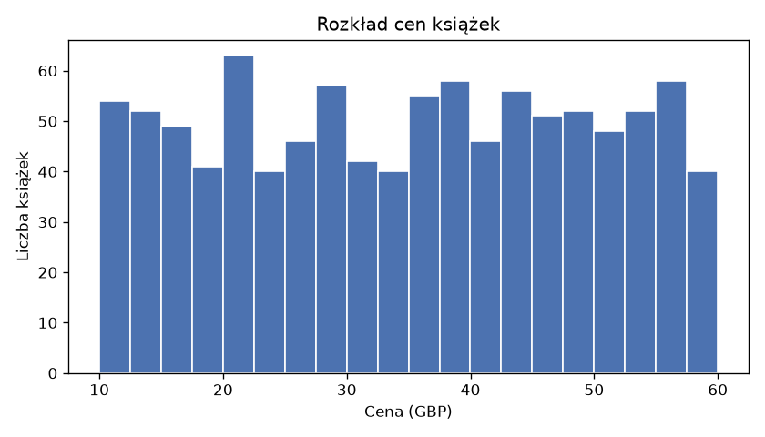
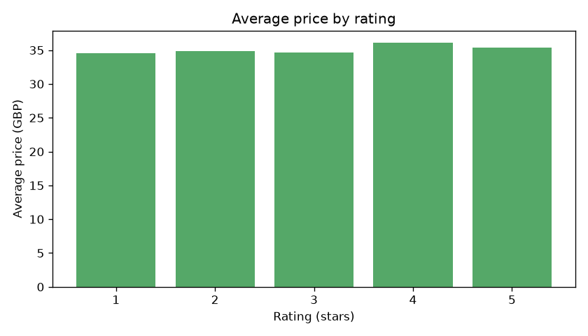
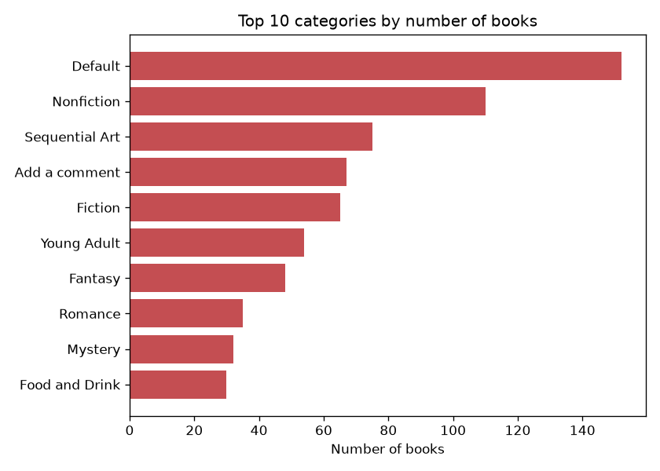

# Book Market Scraper


A scraper that collects data on 1000 books from [books.toscrape.com](https://books.toscrape.com) (a site built for practising web scraping), stores it in an **SQLite** database, then analyses it with **SQL and pandas** and draws charts.

## Problem
An online bookstore wants to know what competitor prices look like: how much books cost in each category and whether better-rated titles are more expensive.

## What the project does
1. `scraper.py` walks through 50 catalogue pages, reads each book's title, price, rating, availability and category, and saves them to `books.db`. Running it again does not create duplicate records.
2. `analysis.py` computes statistics with SQL queries and pandas and saves charts to `charts/`.

## Tech stack
Python, requests, BeautifulSoup, SQLite, pandas, matplotlib, pytest, Docker, GitHub Actions

## How to run
```bash
python -m venv .venv
# Windows: .venv\Scripts\activate    macOS/Linux: source .venv/bin/activate
pip install -r requirements.txt
python scraper.py            # full scrape (about 1000 requests, roughly 15 minutes)
python scraper.py --pages 5 --no-categories   # quick test
python analysis.py
python -m pytest             # tests
```

## Docker
```bash
docker build -t book-market-scraper .
docker run --rm -v "${PWD}/data:/app/data" book-market-scraper   # quick 5-page scrape into data/books.db
docker run --rm -v "${PWD}/data:/app/data" book-market-scraper python scraper.py --db data/books.db   # full scrape
```

## Automation (GitHub Actions)
- [`tests.yml`](.github/workflows/tests.yml) runs the tests and builds the Docker image on every push.
- [`scrape.yml`](.github/workflows/scrape.yml) runs a full scrape and the analysis every Monday (or on demand with "Run workflow") and saves the database and charts as a downloadable artifact, so prices can be compared week by week.

## Results
Data from a full scrape: 1000 books from 50 catalogue pages.

- **Average price:** £35.07, **median:** £35.98. Prices are spread fairly evenly between about £10 and £60.
- **Rating vs. price:** the correlation is **0.028**, i.e. practically zero. Better-rated books are not more expensive: the average price for every star rating falls between £34.56 and £36.09.
- **Categories:** the largest category is **Default** (152 books), followed by the subject categories **Nonfiction** (110) and **Sequential Art** (75). The most expensive on average in the top 10 is **Fantasy** (£39.59).
- All books are in stock.







## What I would add next
- scheduling (e.g. a daily scrape) and tracking price changes over time
- a dashboard in Power BI or Streamlit
